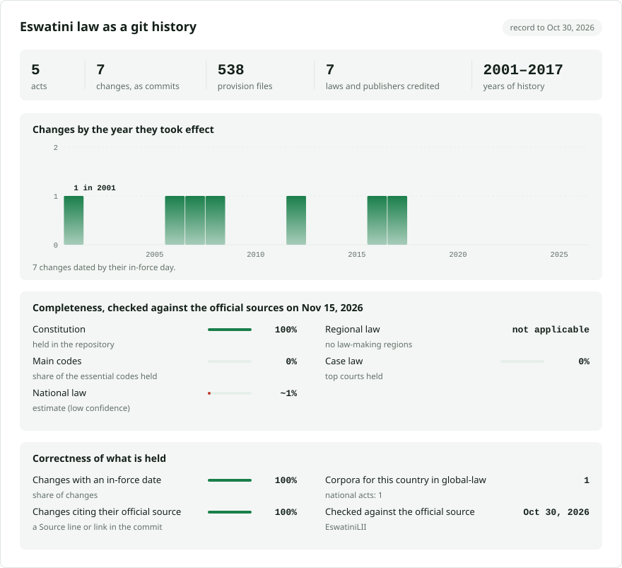

# Eswatini: law history in git

<picture>
<source media="(prefers-color-scheme: dark)" srcset="data/effort-dark.svg">

</picture>

The law of Eswatini as a git history: one file per provision, one commit per version on the day it took effect, and the law that made each change as the commit's author. `git blame` names the law behind every paragraph; `git log` lists every change to a provision; picking a date gives the text in force that day.

Part of [lexifina/global-law](https://github.com/lexifina/global-law), one git history for every country's law: this is Eswatini's national law, which global-law reads at `eswatini/national/acts/`.

**What is in it now:** the Constitution (2005), 57 Acts (court, criminal, labour, land, immigration, finance, environment and agriculture law, 1902 to 2022) and 20 pieces of subsidiary legislation (court rules, regulations, orders, legal notices), from the Judiciary of Eswatini, the Government of Eswatini's gov.sz (archived copies), EswatiniLII (archived copies), FAOLEX and WIPO Lex. [`STRUCTURE.md`](STRUCTURE.md) gives the layout and dating rules.

Each Act is a folder under `acts/<year>/<number>-<slug>/`, subsidiary legislation under `subsidiary/<year>/`, with one file per section and a `README.md` listing its sections (`acts/2008/003-suppression-of-terrorism/sec-005.md` is section 5 of the Suppression of Terrorism Act, 2008, Act 3 of 2008). The Constitution is in `constitution/` (`sec-024.md` is section 24, protection of freedom of expression).

The text is in English, as each source prints it.

## Questions as git commands

| Question | Command |
| --- | --- |
| Every change to section 5 of the Suppression of Terrorism Act | `git log -p --word-diff -- acts/2008/003-suppression-of-terrorism/sec-005.md` |
| Which law wrote each line of section 5? | `git blame acts/2008/003-suppression-of-terrorism/sec-005.md` |
| Every version of the Act, with the day each took effect | `git log --format="%h %(trailers:key=In-force,valueonly,separator=) %an" -- acts/2008/003-suppression-of-terrorism ':!*/README.md'` |
| Section 5 as in force on 1 January 2015 | `python tools/on.py 2015-01-01 acts/2008/003-suppression-of-terrorism sec-005` |

**Outside git**, we also host this record publicly, for free:

- **[Ask Claude about Eswatini law](https://global-law.lexifina.com/v1/try_claude?country=eswatini)**: opens Claude with a first question ready.
- **[Ask ChatGPT](https://global-law.lexifina.com/v1/try_chatgpt?country=eswatini)**: the same question in ChatGPT.
- **[Search Eswatini law on our site](https://lexifina.com/law?country=eswatini&q=freedom+of+expression)**: a search for "freedom of expression", with each provision's text and its versions, no account needed.
- **[Developer REST API](https://global-law.lexifina.com/v1/search_law?query=freedom+of+expression&jurisdiction=eswatini)**: the same search as JSON, with no key. See the [documentation here](https://lexifina.com/api/global-law).

Both assistants read the record through the free Global law connector (MCP, `https://global-law.lexifina.com/mcp`); the first time, the chat gives you the link that adds it. Ask in English.

**Host it yourself easily.** All it takes is git and Python, and the tools run on your machine:

```sh
git clone --depth 1 https://github.com/lexifina/global-law && cd global-law
python3 tools/countries.py add eswatini/national/acts
python3 tools/law.py show 2026-01-01 eswatini/national/acts/acts/2008/003-suppression-of-terrorism/sec-005.md
```

Opened in Claude Code, Cursor, VS Code or Codex, the clone also starts a local MCP server with the same tools ([MCP.md](https://github.com/lexifina/global-law/blob/main/MCP.md)).

## Dates

Each commit is dated at noon, Africa/Mbabane, on the day the version took effect, and carries it in its `In-force:` trailer (with `Enacted:` and `Published:` where EswatiniLII gives them):

- for the first version of an act, the commencement day EswatiniLII states ("Commenced on 8 February 2006 by Constitution of the Kingdom of Swaziland (Date of Commencement) Proclamation, 2006"), not the day it was published in the Gazette (26 July 2005);
- for an amendment, the day of EswatiniLII's version that takes it in, the amending Act's commencement: Act 5 of 2016 and Act 11 of 2017 both took effect on the day they were published (28 September 2016, 25 August 2017);
- the Money Laundering Act's first version is dated 23 March 2012, the commencement EswatiniLII states, which Act 5 of 2016 fixed.

Versions added from November 2026 are dated by the text's own "Date of commencement", the Gazette date for a text that comes into force on publication, a commencement notice, or the FAOLEX/WIPO Lex entry-into-force date; a consolidated text is dated by the day its publisher made the PDF (the text was in force then at the latest). `In-force-basis:` names the rule; [`STRUCTURE.md`](STRUCTURE.md) lists them. Texts with no reliable day are held back.

Each change is credited to the amending Act EswatiniLII's History names for that version (`Act 11 of 2017 <act-2017-11@eswatinilii.invalid>`), and the first version of each act to the act itself, as enacted. A version taking in several Acts would be credited provision by provision from EswatiniLII's editorial notes, the rest to the publisher; none does so far.

## How it is checked

- `tools/check_repo.py` reads every version back from git on the day it took effect and on the day before, and compares it with the corpus: 7 versions of 5 acts, 0 mismatches (see [`REPRODUCE.md`](REPRODUCE.md)).
- Each version is parsed from a copy of that version's own EswatiniLII page, whose sha256 is in `data/versions.json`; the newest version of each act is the one EswatiniLII lists as current, or the act's History lists no later amendment.
- A second build from the same corpus gave identical hashes for all 7 commits and 14 tags.
- No merge commits, no commit dates going backwards, none dated after the build, and every commit's trailers parse.
- [vulnerabilities/](vulnerabilities/): possible drafting mistakes in this law, found by global-law's detectors and checked by hand. Not run yet.

## What it does not show

- **Most Eswatini law.** No case law, and many Acts are missing: gov.sz and parliament.gov.sz no longer answer, so only their archived PDFs are used; scanned PDFs without a text layer are left out (no OCR is run); the Criminal Procedure and Evidence Act 1938, the Employment Act 1980 and the Companies Act 2009 were not found in any usable official or secondary copy; texts with no reliable in-force day are held back (see `In-force-basis` in [`STRUCTURE.md`](STRUCTURE.md)).
- **Other versions.** The Constitution, the Prevention of Corruption Act and the Serious Offences Act have one version each; amendments EswatiniLII has not consolidated, and anything after the record was retrieved (28 and 30 October 2026), are not here.
- **The Gazette text.** The text was not compared with the Government Gazette, whose copies are scans (no OCR is used); EswatiniLII itself notes for the Constitution, the Money Laundering Act and the Prevention of Corruption Act that the original publication "is not available and this content could not be verified".
- **Editorial notes and headings.** EswatiniLII's bracketed notes are left out of the text (unless a provision has no other text) and used only for credits, and Part and Chapter headings are left out; each file starts with its own number and heading.
- **The amending Acts' own text.** Act 5 of 2016 and Act 11 of 2017 are PDF only on EswatiniLII; their changes are here as its consolidated versions print them.

## Sources

| Source | Kind | Past versions | Notes |
| --- | --- | --- | --- |
| [EswatiniLII](https://eswatinilii.org) (the Judiciary of Eswatini, on Laws.Africa's Peachjam platform) | Legal information institute | yes, dated point-in-time versions of each act | Each version's text, its History and amendment list, and per-provision editorial notes; read from the Internet Archive's copies of its pages |
| [Judiciary of Eswatini](https://www.judiciary.org.sz/legislation) | Official | no | Court Acts and rules, the Industrial Relations Act and the Sexual Offences and Domestic Violence Act, as PDFs with their own text layer |
| Government of Eswatini, [gov.sz](https://www.gov.sz) | Official (archived copies) | as enacted and consolidated | Acts, Gazette extraordinaries and legal notices as PDFs; the host stopped answering, so the Internet Archive's copies are read |
| [FAOLEX](https://faolex.fao.org) (FAO) | Secondary copy | as enacted | Land, environment and agriculture Acts and regulations; many are scans whose text layer is FAO's OCR (`Text-source: publisher OCR`) |
| [WIPO Lex](https://www.wipo.int/wipolex/en/members/profile/SZ) | Secondary copy | as enacted | Intellectual property and trade Acts |

## Licence

See [`LICENSE`](LICENSE). EswatiniLII licenses its content CC BY-NC 4.0, crediting EswatiniLII as the source, so its texts may be used only for non-commercial purposes; FAOLEX texts are for non-commercial reuse with credit to FAO; official Government and Judiciary texts are reproduced as public law; Lexifina's arrangement of the history, the commit messages, the tables and the tools are CC0 1.0.

No AI model wrote, translated or corrected legal text; the scripts that read the sources and build this repository were written by an AI model (see [`REPRODUCE.md`](REPRODUCE.md)).

## Visualisations

- [visualisations/](visualisations/): charts drawn from this repository. Not drawn yet.

## More

From [lexifina/global-law](https://github.com/lexifina/global-law):

- [FEATURES.md](https://github.com/lexifina/global-law/blob/main/FEATURES.md): every feature, and what every corpus must support (`git blame`, `law.py`, the MCP tools)
- [FAQ.md](https://github.com/lexifina/global-law/blob/main/FAQ.md): questions and answers · [CONTRIBUTING.md](https://github.com/lexifina/global-law/blob/main/CONTRIBUTING.md): proposing changes · [MCP.md](https://github.com/lexifina/global-law/blob/main/MCP.md): the MCP server · [REPRODUCE.md](https://github.com/lexifina/global-law/blob/main/REPRODUCE.md): how it was built · [CHANGELOG.md](https://github.com/lexifina/global-law/blob/main/CHANGELOG.md)
- [FRESHNESS.md](https://github.com/lexifina/global-law/blob/main/FRESHNESS.md): how current each corpus is · [Monitoring](https://github.com/lexifina/global-law/tree/main/monitoring): whether updates are running · [WATCHING.md](https://github.com/lexifina/global-law/blob/main/WATCHING.md): how each official source is watched for changes
- [performance/](https://github.com/lexifina/global-law/tree/main/performance): how fast the tools are, measured
- [visualisations/](https://github.com/lexifina/global-law/tree/main/visualisations): charts and bridges across the world's law
- [Vulnerabilities](https://github.com/lexifina/global-law/tree/main/vulnerabilities): mistakes in legislation as published
